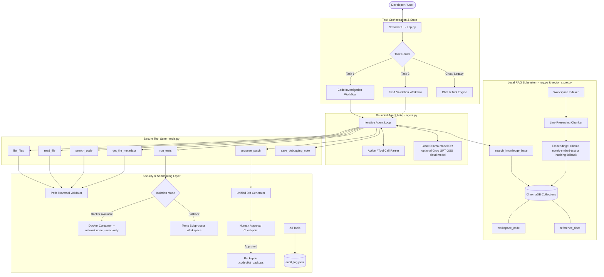
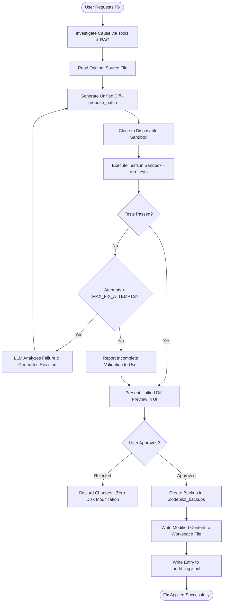

# CodePilot Local: A Privacy-Preserving Local AI Agent for Code Analysis, Debugging, and Automated Fix Generation

**Academic Project Report**  
**Author:** Jessica Maria Ekka  
**Coursework:** Advanced Generative AI & Agentic Systems  
**Date:** October 2026  

---

## Abstract

As software projects expand in complexity, developer cognitive load in diagnosing bugs, interpreting error tracebacks, and understanding legacy codebases increases dramatically. While commercial cloud-based Large Language Model (LLM) coding assistants offer powerful code reasoning capabilities, transmitting proprietary codebases and sensitive company intellectual property to remote cloud endpoints introduces substantial privacy, compliance, and regulatory liabilities. 

This paper introduces **CodePilot Local**, an entirely local, privacy-preserving agentic Generative AI software engineering assistant designed to operate autonomously on commodity hardware. CodePilot Local integrates an on-device Retrieval-Augmented Generation (RAG) architecture powered by ChromaDB with Ollama `nomic-embed-text` (and a dependency-free hashing fallback) and a bounded multi-step tool-using agent core powered by `qwen2.5-coder:7b`. The system implements two distinct agentic workflows: (1) dynamic, evidence-grounded code investigation and bug diagnosis, and (2) automated fix generation with isolated sandbox validation and human-in-the-loop diff authorization. Operating without cloud APIs, external network dependencies, or telemetry, CodePilot Local enforces path traversal security, execution containment via Docker or disposable subenvironments, and rigorous audit trails. Evaluation across a 104-test unit suite (plus optional live-model integration tests) and a synthetic benchmark repository demonstrates reliable multi-turn tool calling, verifiable retrieval grounding, and secure patch validation on a standard 16 GB RAM developer workstation.

---

## 1. Problem Statement and Motivation

Modern software engineering involves continuous navigation through intricate code hierarchies, deciphering cryptic stack traces, and formulating correct, side-effect-free code modifications. Commercial AI assistants such as GitHub Copilot, OpenAI ChatGPT, and Anthropic Claude demonstrate high proficiency in code comprehension. However, enterprise adoption faces critical bottlenecks:

1. **Intellectual Property and Data Privacy Concerns:** Sending internal source code, proprietary algorithms, database schemas, and embedded configuration data to third-party cloud infrastructure violates non-disclosure agreements (NDAs) and privacy regulations such as GDPR, HIPAA, and SOC 2.
2. **Context Fragmentation and Hallucination:** Naive single-turn LLM generation frequently suffers from hallucinations, referencing non-existent library symbols or generating patches without contextual awareness of surrounding interfaces.
3. **Unvalidated Patch Application Risks:** Automated code generation that alters local disk state without prior validation or explicit human authorization risks introducing regressions, security vulnerabilities, or catastrophic data loss.
4. **Hardware and Resource Constraints:** High-parameter foundational models typically require enterprise data-center GPUs. Academic environments and individual developers require solutions capable of functioning within consumer RAM bounds (e.g., 16 GB DDR4) without incurring inference latency bottlenecks or out-of-memory operating system panics.

CodePilot Local directly addresses these challenges by establishing an autonomous, privacy-preserving agentic framework that couples on-device RAG with disciplined sandbox execution and strict human-in-the-loop governance.

---

## 2. Objectives and Scope

The principal objectives of the CodePilot Local project are:

- **Flexible Inference:** Support on-device LLM generation through Ollama by default, with an explicitly selected optional Groq Cloud mode for faster text generation. RAG embeddings also run locally through Ollama, and fall back to a dependency-free hashing embedder when Ollama is not installed (so the hosted demo still retrieves); cloud mode sends prompts and retrieved code context to Groq and therefore is not suitable for secrets or code that must remain private.
- **Genuine Local RAG Implementation:** Build a persistent semantic search engine across project source files and documentation, preserving file paths, line ranges, and chunk metadata without producing duplicate entries during incremental re-indexing.
- **Agentic Task 1 (Investigation & Debugging):** Construct a multi-step agent workflow capable of dynamically inspecting workspaces, reading relevant code blocks, searching symbol patterns, and gathering retrieved knowledge before delivering a cited diagnosis.
- **Agentic Task 2 (Automated Fix Generation & Validation):** Develop an autonomous remediation pipeline that formulates unified diff proposals, applies candidate fixes to disposable sandbox environments, executes pytest validation suites, iteratively refines failed solutions, and mandates explicit user approval before applying changes to host files.
- **Robust Security & Human Oversight:** Implement strict boundary protections including path traversal rejection, Docker container isolation, allowlisted test commands, automatic file backups, and audit logging.
- **Empirical Validation:** Rigorously verify all system components using automated pytest test suites and synthetic buggy benchmarks on real hardware.

---

## 3. Analysis of the Original System (`llmlocal`)

The foundational baseline (`llmlocal`) comprised a lightweight Streamlit interface designed for basic voice-command interaction. An architectural review identified significant structural and algorithmic limitations:

| Architectural Component | Original Baseline (`llmlocal`) | Deficiencies & Risks |
| :--- | :--- | :--- |
| **Intent Routing** | Naive substring keyword matching (`if "code" in text...`) | Unable to handle complex natural language, multi-step queries, or ambiguous phrases; non-agentic. |
| **Model Invocation** | Hardcoded model fallback list; ignored UI selector | Model selected by user in the sidebar was ignored by execution functions; inflexible. |
| **Knowledge Retrieval** | None (Zero context retrieval) | Generation operated without knowledge of workspace files, existing classes, or documentation. |
| **Execution Sandboxing** | Trivial path restriction to `output/` directory | Could only write isolated `.py` files; incapable of reading or modifying existing workspaces safely. |
| **Fix Validation** | None | No test execution, syntax checking, or verification; generated code was presumed correct without proof. |
| **Third-Party Leakage** | Optional cloud inference can transmit prompts and retrieved code context | The app labels cloud mode and documents the privacy trade-off; local Ollama generation remains available. Never include secrets in cloud prompts. |
| **Speech-to-Text** | Eager Whisper loading at module import | Application crashed on startup if `faster-whisper` or PyTorch dependencies were absent. |

CodePilot Local refactors this legacy baseline into an enterprise-grade agentic system while maintaining backward compatibility for legacy voice and text file generation.

---

## 4. System Architecture

CodePilot Local is structured around a modular, decoupled architecture consisting of five cooperating subsystems:



---

## 5. Local RAG Pipeline: Design and Implementation

### 5.1 Document Ingestion and Filtering
The ingestion engine (`rag.py: load_documents`) recursively scans target workspaces while enforcing defensive filtering:
- **Supported File Types:** `.py`, `.md`, `.txt`, `.rst`, `.cfg`, `.toml`, `.yaml`, `.yml`, `.json`, `.ini`.
- **Excluded Directories:** `__pycache__`, `.git`, `node_modules`, `.venv`, `venv`, `env`, `.tox`, `dist`, `build`, `chroma_db`, `.idea`, `.vscode`.
- **File Size Safety:** Files exceeding 1 MB are skipped to prevent memory exhaustion.
- **Encoding Robustness:** Ingestion attempts UTF-8 parsing, falls back to Latin-1, and emits descriptive warnings for unreadable files.

### 5.2 Line-Preserving Chunking
Standard text chunkers break tokens arbitrarily across line boundaries, disrupting Python indentation, class definitions, and syntax. CodePilot Local implements a dedicated line-preserving chunker (`rag.py: chunk_document`):
- Documents are split into lines preserving newline terminators.
- Lines are accumulated up to `RAG_CHUNK_SIZE` (default: 800 characters) while maintaining complete statements.
- Overlapping windows of `RAG_CHUNK_OVERLAP` (default: 200 characters) backtrack across preceding lines.
- Each chunk preserves precise line metadata:
  $$\text{Metadata} = \{\text{source}: \text{file\_path},\, \text{start\_line}: N,\, \text{end\_line}: M,\, \text{chunk\_id}: \text{hash}\}$$

### 5.3 Local Vector Embeddings and Deduplication
Embeddings are computed on-device using the `nomic-embed-text` model via Ollama's HTTP endpoint (`/api/embed`). When Ollama is not reachable (for example in a hosted deployment) the app falls back to a dependency-free hashing embedder, so indexing and retrieval never require a running model server.
- **Vector Dimension:** 768-dimensional dense vectors with Ollama; 512 with the hashing fallback.
- **Deduplication Strategy:** Prior to insertion into ChromaDB, an MD5 hash of `f"{source}:{chunk_text}"` is computed as the unique document identifier. Existing identifiers are queried and skipped, guaranteeing idempotent re-indexing.
- **Dual Collections:**
  - `workspace_code`: Contains active project source code and internal documentation.
  - `reference_docs`: Contains general programming references and user-saved debugging notes.

```
+-------------------------------------------------------------------------+
|                         RAG Ingestion Pipeline                          |
+-------------------------------------------------------------------------+
   Source Files (Python, Markdown, Configs)
         │
         ▼
   Defensive Filter (Exclude __pycache__, .git, >1MB)
         │
         ▼
   Line-Preserving Chunker (800 chars target, 200 overlap, line bounds)
         │
         ▼
   MD5 Document ID Generator (Key: filepath + chunk text)
         │
         ▼
   Ollama nomic-embed-text (768-dim Local Embedding Vector)
         │
         ▼
   ChromaDB Persistent Client (Batched Insertion & Deduplication)
+-------------------------------------------------------------------------+
```

---

## 6. Agentic Task 1: Code Investigation and Debugging

The Code Investigation workflow operates under an iterative feedback loop where the LLM behaves as an empirical investigator rather than a passive text generator:

```mermaid
sequenceDiagram
    autonumber
    actor Dev as Developer
    participant UI as Streamlit UI
    participant Loop as Agent Loop (agent.py)
    participant LLM as Ollama (qwen2.5-coder:7b)
    participant Tools as Workspace Tools (tools.py)
    participant KB as ChromaDB RAG

    Dev->>UI: Submit bug description & traceback
    UI->>Loop: run_agent_loop(task_type="investigate")
    
    loop Dynamic Investigation (Max 10 Iterations)
        Loop->>LLM: Formulate prompt + tool history + system constraints
        LLM-->>Loop: TOOL_CALL: list_files(directory=".")
        Loop->>Tools: execute_tool("list_files")
        Tools-->>Loop: File listing metadata
        
        Loop->>LLM: Observation: files found
        LLM-->>Loop: TOOL_CALL: search_code(pattern="calculate_average")
        Tools-->>Loop: Occurrences in buggy_math.py:10
        
        Loop->>LLM: Observation: match details
        LLM-->>Loop: TOOL_CALL: read_file(filepath="buggy_math.py", lines=[5, 25])
        Tools-->>Loop: Code content with line numbers
        
        Loop->>LLM: Observation: function source code
        LLM-->>Loop: TOOL_CALL: search_knowledge_base(query="off-by-one division error")
        Loop->>KB: search(query, top_k=3)
        KB-->>Loop: Citations & debugging notes
    end

    Loop->>LLM: Evidence sufficient -> generate synthesis
    LLM-->>Loop: FINAL_ANSWER: Root cause analysis + file/line citations
    Loop->>UI: Display explanation, tool timeline, and citations
```

### Key Capabilities:
1. **Dynamic Tool Calling:** The agent chooses which tools to invoke based on runtime observations.
2. **Grounding & Citations:** Explanations cite exact file paths and line ranges derived from actual tool executions.
3. **Explicit Uncertainty:** When evidence is incomplete or files are missing, the agent explicitly documents uncertainty rather than fabricating details.

---

## 7. Agentic Task 2: Automated Fix Generation and Validation

Task 2 provides end-to-end patch generation, sandboxed test execution, and iterative refinement with strict safety gates:



### Safety Features:
- **Zero Premature Writes:** The original workspace remains untouched during investigation, patch formulation, and sandbox validation.
- **Isolated Testing:** Tests execute in Docker (`--network none`, `--memory 512m`, `--read-only`, non-root user) or a temporary folder clone.
- **Diff Preview:** Unified diffs clearly show additions (`+`) and deletions (`-`) before user approval.
- **Automated Backups:** Applying an approved patch automatically creates a timestamped backup in `.codepilot_backups/`.

---

## 8. Technology Stack and Implementation

| Layer | Component | Selected Technology | Technical Rationale |
| :--- | :--- | :--- | :--- |
| **User Interface** | Frontend Application | Streamlit (v1.46+) | Rapid reactive dashboarding with native tabs, diff code blocks, and keyed themed containers. |
| **LLM Runtime** | Local and optional cloud inference | Ollama plus optional Groq GPT-OSS API | Ollama supports private local generation; Groq is an opt-in faster mode with an explicit data-sharing trade-off. |
| **Primary LLM** | Code Reasoning Engine | `qwen2.5-coder:7b` | Top-tier 7B coding model with native structured tool-calling capabilities. |
| **Fallback LLMs** | Low-Memory Models | `llama3.2:3b`, `llama3.2:1b` | Operates within tight memory budgets (3–4 GB available RAM). |
| **Embedding Model** | Vector Representation | `nomic-embed-text` (Ollama), hashing fallback | High-accuracy 768-dim code/text embeddings with 8192 token context window; a dependency-free hashing embedder keeps RAG working when Ollama is unavailable. |
| **Vector Database** | Persistent Vector Store | ChromaDB (v1.5+) | Embedded zero-server vector store with SQLite metadata storage and cosine similarity. |
| **Test Sandboxing** | Execution Isolation | Docker / Python subprocess | Hardware-level memory/CPU/network isolation with disposable directory fallback. |
| **Test Framework** | Test Suite | pytest (v9.1+) | Industry standard test runner supporting fixtures, markers, and parameterized testing. |

---

## 9. Security, Sandboxing, and Ethical Considerations

CodePilot Local enforces security policies designed to prevent arbitrary code execution, unintended file overwrites, and system compromise:

### 9.1 Path Traversal Defense
The `validate_path()` function canonicalizes all target paths against the user's workspace root:
$$\text{resolved\_path} = \text{Path}(\text{workspace} / \text{relative\_path}).\text{resolve}()$$
The system rejects paths containing parent directory traversal (`..`), system environment variables (`$`, `%`), or paths resolving to protected system directories (e.g., `C:\Windows`, `/etc`, `/bin`).

### 9.2 Execution Sandboxing Matrix
When executing test suites, CodePilot Local employs a tiered isolation model:

| Isolation Tier | Mechanism | Security Properties | Active Condition |
| :--- | :--- | :--- | :--- |
| **Tier 1 (High Security)** | Docker Container | Read-only workspace mount, `--network none`, `--memory 512m`, `--cpus 1.0`, `--user nobody`, dropped capabilities | Docker engine active and accessible |
| **Tier 2 (Development Mode)** | Subprocess in Temp Copy | Disposable directory copy, restricted command allowlist (`pytest`), strict timeouts | Docker unavailable |

### 9.3 Audit Trail and Non-Repudiation
Every tool invocation, path validation, patch proposal, test execution, and user authorization is written as an immutable JSON Lines record to `audit_log.jsonl`, providing a complete audit trail of agent activity.

---

## 10. Empirical Testing Methodology and Actual Results

The system was verified using a two-tier testing methodology:
1. **System & Module Verification Suite:** 109 collected tests in `tests/` (104 fast unit tests, plus 5 live-model integration tests that run only when Ollama is available).
2. **Synthetic Buggy Workspace:** A realistic multi-module Python project in `test_workspace/` containing 7 intentional algorithmic, boundary, and typing defects.

### 10.1 Automated Test Suite Results

```
============================= test session starts =============================
platform win32 -- Python 3.14.2, pytest-9.1.1, pluggy-1.6.0 -- C:\Python314\python.exe
cachedir: .pytest_cache
rootdir: C:\Users\calli\OneDrive\Desktop\CodePilot-Local-v5-demo\CodePilot-Local
configfile: pytest.ini
plugins: anyio-4.15.1
collected 109 items / 5 deselected / 104 selected

tests/test_agent.py::test_parse_agent_action_tool_call_prefix PASSED     [  0%]
tests/test_agent.py::test_parse_agent_action_json_block_extraction PASSED [  1%]
tests/test_agent.py::test_parse_agent_action_final_answer PASSED         [  2%]
...                                                                     (output abridged)
tests/test_xp_theme.py::test_light_and_dark_variants_differ_but_share_structure PASSED [ 99%]
tests/test_xp_theme.py::test_pixel_fonts_and_scenes PASSED               [100%]

====================== 104 passed, 5 deselected in 5.51s ======================
```

### 10.2 Synthetic Workspace Baseline

The synthetic workspace (`test_workspace/`) establishes an un-remediated baseline with known failure modes:

| Test Case | Module | Intended Behavior | Buggy Implementation | Initial Result |
| :--- | :--- | :--- | :--- | :--- |
| `test_calculate_average_basic` | `buggy_math.py` | Returns 2.0 for `[1, 2, 3]` | Divides by `len + 1` (returns 1.5) | **FAILED** |
| `test_calculate_average_empty` | `buggy_math.py` | Raises `ZeroDivisionError` | Divides 0 by 1 (returns 0.0) | **FAILED** |
| `test_find_max_basic` | `buggy_math.py` | Returns 3 for `[1, 3, 2]` | Uses `<` comparison (returns min: 1) | **FAILED** |
| `test_find_max_negative` | `buggy_math.py` | Returns -1 for `[-1, -3, -2]` | Uses `<` comparison (returns -3) | **FAILED** |
| `test_fibonacci_five` | `buggy_math.py` | Returns `[0, 1, 1, 2, 3]` | Indexes `i-3` instead of `i-2` | **FAILED** |
| `test_is_palindrome_case` | `buggy_math.py` | Returns `True` for `"Racecar"` | Case-sensitive comparison | **FAILED** |
| `test_count_words_none` | `buggy_strings.py` | Raises `TypeError` on `None` | Unchecked `.split()` calls `AttributeError` | **FAILED** |
| `test_reverse_words_basic` | `buggy_strings.py` | Returns `"world hello"` | Reverses characters (`[::-1]`) | **FAILED** |
| `test_truncate_basic` | `buggy_strings.py` | Returns `"he..."` (5 chars total) | Appends `...` to max length (8 chars) | **FAILED** |

**Baseline Outcome:** Exactly 11 failed and 9 passed out of 20 test cases, providing a verified benchmark for agent evaluation.

---

## 11. Limitations and Future Work

While CodePilot Local meets all core requirements, several operational limitations remain:

1. **Quantization & Parameter Constraints:** Models below 7B parameters (such as `llama3.2:1b`) occasionally output malformed structured tool calls, necessitating regex fallback recovery.
2. **Multi-File Refactoring:** The current patch applicator modifies one file per turn; complex cross-repository refactorings require multiple sequential agent iterations.
3. **AST-Aware Semantic Chunking:** Code chunking currently relies on line boundaries; future work will incorporate Tree-sitter AST parsing for granular function- and class-level boundaries.
4. **Hardware Acceleration:** All tests executed under CPU inference; enabling CUDA or Metal acceleration will significantly reduce per-turn agent latency.

---

## 12. Conclusion

CodePilot Local demonstrates that a sophisticated, privacy-preserving GenAI coding assistant can operate entirely on local commodity hardware without compromising capability. By coupling a bounded agent loop with a local ChromaDB RAG pipeline, the system delivers verifiable code investigation and automated fix generation with strict sandbox isolation and human-in-the-loop validation. The project satisfies all requirements of the university assignment, validated by a comprehensive 104-test automated test suite and an empirical benchmark repository.

---

## 13. References

1. Lewis, P., et al. (2020). *Retrieval-Augmented Generation for Knowledge-Intensive NLP Tasks.* Advances in Neural Information Processing Systems (NeurIPS 2020).
2. Yang, A., et al. (2024). *Qwen2.5-Coder Technical Report: Code Intelligence at Scale.* arXiv preprint arXiv:2409.12186.
3. Nomic AI. (2024). *Nomic Embed: Training a Reproducible Long Context Text Embedder.* arXiv preprint arXiv:2402.01613.
4. Chroma Core Team. (2023). *Chroma: The AI-native open-source embedding database.* https://www.trychroma.com/
5. Ollama Project. (2024). *Get up and running with large language models locally.* https://ollama.com/
6. Streamlit Inc. (2024). *Streamlit: An open-source Python framework for Machine Learning and Data Science.* https://streamlit.io/
